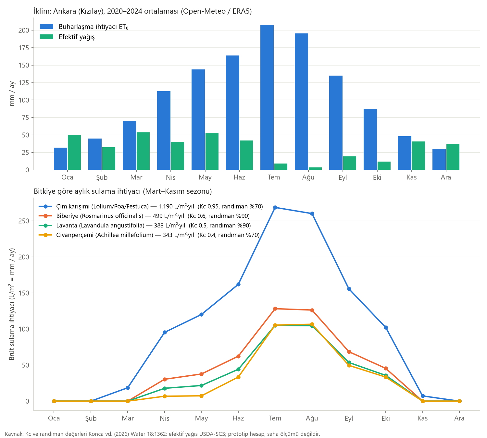

# Florify – Belediyeler için Su Tasarruflu Peyzaj Karar Aracı

**Water AI Hackathon 2026 (Wilo)** projesi.  
Dayanak: **Cumhurbaşkanı Kararı 10502** (RG 18.10.2025/33051) — belediyelerin çim alanlarını azaltması ve her yıl **Peyzaj İzleme Sistemi (EK-1)**'ne veri girmesi gerekiyor.

Amaç: Bir park ya da ilçede mevcut çimin ne kadar su istediğini, yerine hangi bitkiler konursa ne kadar su ve bütçe tasarruf edileceğini (P10–P90 belirsizlik aralığıyla), uydudan nerede sulanan yeşil olduğunu, 2040 iklim riskini ve CB Kararı 10502 **EK-1 taslak formunu** yalnızca açık verilerle üretmek.

---

## Ne Çalışıyor?
- **Hesap çekirdeği (`src/hesap/`):** FAO-56 Penman-Monteith (`ET₀ × Kc(ay) × kd − Peff ÷ randıman`), Monte Carlo belirsizlik bandı (P10–P90), basit geri ödeme (ROI), doğrulanmış ASKİ/İZSU/İSKİ tarifeleri ve **CB Kararı 10502 EK-1** form üreticisi.
- **Bitki kataloğu (`kaynaklar/veri/`):** Konca vd. (2026) tablosundan **135 tekil tür** + Türkçe adlar, gerçek gölge ağacı ayrımı, EK-1 kategorisi ve Tarım ve Orman Bakanlığı Rehberi (2024) Çizelge 4–5 eşleşmesi.
- **Bitki karışımı optimizasyonu (`src/model/oneri.py`):** Karma tamsayılı doğrusal programlama (`scipy.optimize.milp`); oyun çimi, gerçek gölge ağacı, çalı/çiçek katmanı ve çeşitlilik kısıtlarıyla en az su isteyen karışımı seçer *(optimizasyondur, makine öğrenmesi değildir)*.
- **Uydu sulanan yeşil tespiti (`src/uydu/`):** ESA WorldCover 2021 + Sentinel-2 Temmuz–Ağustos NDVI (> 0,5) + kentsel maske. İzmir'in 11 merkez ilçesinde İZSU 2023 gerçek park/mezarlık faturalarıyla **Spearman ρ = 0,85** (kentsel alan sabitken kısmi **ρ = 0,70**). Web panelinde İzmir ilçelerine anında yakınlaşır ve 81 il/ilçe için canlı analiz çalıştırır.
- **2040'lar iklim senaryosu (`src/veri/projeksiyon.py`):** 7 CMIP6 HighResMIP modeli (yüksek emisyon, kötümser uç) ve delta yöntemi. Ankara'da çimin m² başına artışı (+%6, 7/7 model artış) kurakçıl peyzajın ~2,7 katı.
- **Denenip bırakılan katman (dürüstlük notu):** LightGBM ile 1–3 aylık sezon tahmini (AI-1) denendi; son 10 yıl ortalamasından %5–7 kötü çıktığı için bırakıldı (`docs/ai1_deneme_sonucu.md`).
- **Arayüzler:** Hafif HTML/JS web arayüzü (`web/sunucu.py`, önerilen) ve Streamlit paneli (`app/panel.py`).

---

## Doğrulama Özeti
- **Las Vegas sayaç ölçümü (SNWA, 1995–2001):** Aylık profil **r = 0,96**; tasarruf hesabımız **%62**, ölçülen **%76** (temkinli).
- **İzmir gerçek sulama faturaları (İZSU, 2014–2024):** Mevsimsellik **r = 0,89** (1 ay gecikmeyle 0,97).
- **Ankara hakemli çalışma (Konca vd. 2026):** Çim hesabımız **1.190 L/m²·yıl** (makale 1.140 L/m²·yıl; Batıkent m² karşılaştırmaları ±%15 içinde).

*Not: Paneldeki tüm su miktarları FAO-56 hesabıdır, saha ölçümü değildir.*



---

## Kurulum ve Çalıştırma
```powershell
py -3 -m venv .venv
.venv\Scripts\python -m pip install -r requirements.txt

.venv\Scripts\python web/sunucu.py                  # web arayüzü (http://localhost:8000, önerilen)
.venv\Scripts\python -m streamlit run app/panel.py  # alternatif Streamlit paneli (http://localhost:8501)
.venv\Scripts\python -m pytest                      # birim ve doğrulama testleri
```

## Klasörler
- `src/`: hesap çekirdeği (`hesap/`), optimizasyon (`model/`), uydu (`uydu/`), iklim & projeksiyon (`veri/`)
- `web/`: doğrudan `src/` modüllerine bağlı hafif HTML/CSS/JS web arayüzü
- `app/`: 4 sayfalık Streamlit paneli
- `tests/`: hesap, doğrulama, konum, öneri, projeksiyon, uydu ve web API testleri
- `docs/`: teknik plan, doğrulama raporları ve [sunuma kadar yapılacaklar](docs/sunuma_kadar_yapilacaklar.md)
- `kaynaklar/`: açık makaleler, resmi mevzuat (CB Kararı 10502, Bakanlık Rehberi 2024) ve veri tabloları
